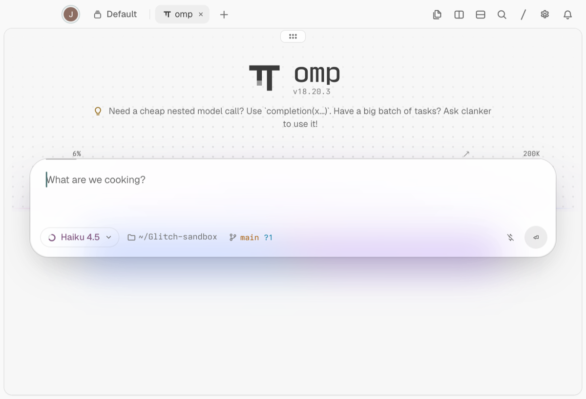
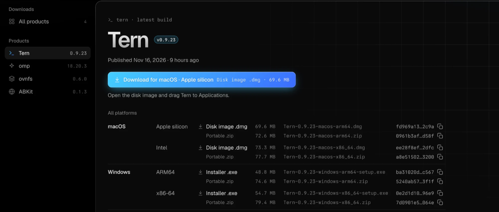
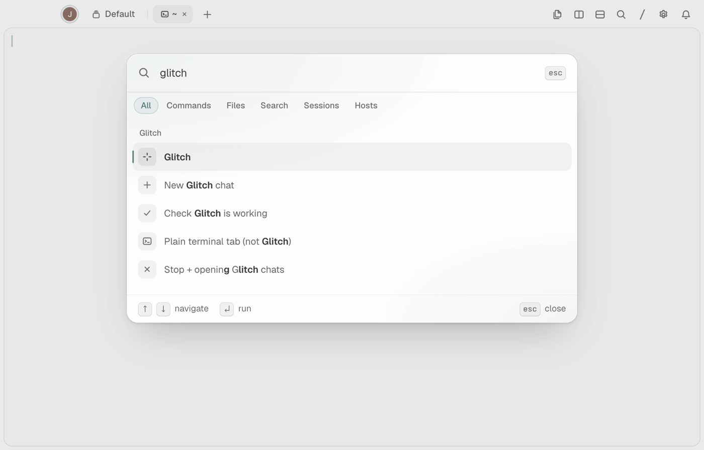
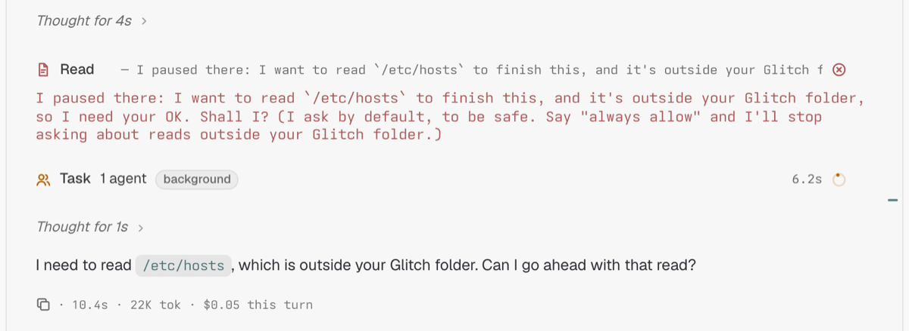

# Glitch for omp (the agent inside Tern)

**Use your Glitch memory and safety guards inside omp, with any AI model omp can talk to.**

A community add-on by James, Glitch Cat Club member. Free, MIT licence.
It is **not** part of Glitch and it is **not** made or supported by the Glitch team.

---

## What is this, in plain English?

- **Glitch** is your second brain. It remembers you, and it has safety guards that stop an AI doing something
  silly to your files.
- **omp** is a free AI coding agent that runs in a terminal and can talk to lots of models, not only Claude.
- **Tern** is a terminal app that runs omp in a nicer window. It is optional.
- Glitch already works in Claude Code, Codex and Cursor. omp finds Glitch's skills by itself, but it does
  **not** run Glitch's hooks, and the hooks are where your identity, your memory and the safety guards live.
  This add-on runs them inside omp. It is one file, [`src/glitch.ts`](src/glitch.ts).

Where Glitch is on, you get: the AI knows you from the first message, the guards are on, and your chats are
saved into your memory. Anywhere else, the add-on does nothing at all.


*omp inside Tern, started in a Glitch folder.*

---

## Why bother? (how I use it)

omp lets you point Glitch at **any** model, so you are never tied to one company. This is how I use it. It is
my setup, not advice, and prices change.

- **What I pay for:** a **Claude Max** subscription, and an **OpenCode Go** subscription, which gives me the
  cheapest access I have found to the best Chinese models. I also have API access connected for OpenCode and
  Jev (see the end of this section), for anything else I need.
- **Two layers.** The **workhorse layer** is OpenCode Go. It handles most of the tokens (roughly 80%):
  helpers, searching, test loops, routine builds. It stays the same whichever lab is ahead. The **frontier
  slot** (about £90 a month for me, today Claude Max) handles the hardest 20%: architecture, planning and hard
  bugs.
- **Why that works (musical chairs).** The best model keeps changing hands. If OpenAI or Google overtakes
  Claude next month, I rebuild nothing. I cancel Claude Max at the end of the billing month and put the same
  budget into the new winner. Glitch (your memory, guards and skills) sits on top and does not care which model
  is underneath.

That last part is what this add-on gives you in omp. **omp works with all of these**: your Claude subscription,
your ChatGPT subscription, OpenCode Go, OpenRouter and more, and you can switch model inside a chat. If
OpenCode Go is not enough, I plan to move the workhorse layer to **Alibaba**. omp can add anything that speaks
the OpenAI API in its `models.yml` file ([omp's models.yml docs](https://github.com/can1357/oh-my-pi/blob/main/docs/models.md)), which is how I expect to add it. You only
need **one** model login to start.

In omp the two layers are just two model choices: the main chat on your frontier model, and its helpers on your
workhorse model (see "Helpers" under "Skills" below). The same idea is how I set up OpenCode, and I made a
sibling add-on for that too: [glitch-opencode-adapter](https://github.com/MrEvanscodes/glitch-opencode-adapter).

**On the side: Jev.** I have also set up **Jev** from [TypeSafe AI](https://typesafe.ai) through its API. It is a
decision model, not a chatbot: you give it some state and typed questions, and it answers with typed results and
probabilities, so there is no text to parse. That suits things like routing, flagging and scoring. I am
interested in using it for some things. It is not part of this add-on.

---

## Pick your way

You can use omp **with Tern** or **without it**. I recommend Tern, and use it myself.

| | **Way 1: with Tern** (recommended) | **Way 2: without Tern** (omp in the Terminal) |
|---|---|---|
| What it is | A terminal app with a nicer window. omp is built in. | omp running in the Terminal app that is already on your Mac. |
| Getting it | Closed beta: join a waitlist, then download. | One command, today. |
| Starting Glitch | Press `⌘ + K`, type `glitch`, press Enter. | `cd ~/Glitch && omp` |
| Pick it if | You want the nicest experience. | You want to start right now, or do not want another app. |

You can start with Way 2 today and add Tern later: nothing you install here has to be redone.

## What you need

| You need | Why | Where to get it |
|---|---|---|
| A Mac | Only tested on an Apple silicon Mac. Glitch itself runs on Windows and Linux; this add-on has **not** been tried there. | |
| **Glitch, already set up** | This add-on plugs into it. | [Glitch's own setup](https://github.com/Glitch-Cat-Club/glitch#get-started): clone it, open it in VS Code, install Claude Code, install uv, run `/setup`. Do that first. |
| **uv** | Glitch's guards run on it. | Glitch's own setup has you install it (step 3 of its "Get started"). Check: `uv --version` |
| **omp**, version **18.20.3** (the only version tested) | The agent this add-on plugs into. | **Way 1:** comes with Tern. **Way 2:** install it on its own. Both below. Check: `omp --version` |
| **A model login in omp** | So omp can talk to a model. | `omp login` (below) |
| **Tern** (Way 1 only) | The nicer window, and one-click Glitch chats. | Closed beta: join the waitlist at https://stencil.so/tern, then download. Below. |

### Opening the Terminal, and the grey boxes

The **Terminal** is the app where you type commands. Press `⌘ + Space`, type `Terminal`, press Enter. Every grey
box in this page is something to **copy, paste into the Terminal, and press Enter on**. Do them one at a time.

## Way 1: with Tern (recommended)

Tern is a terminal app from Stencil, the team that makes omp (docs: https://docs.stencil.so/tern/). It is in
**closed beta**, so you ask for access first:

1. Go to **https://stencil.so/tern** and join the waitlist. (I joined one evening and had access the next
   morning. Yours may take longer. You do not have to wait: start with Way 2 meanwhile.)
2. When you are let in, open Tern's download page. Choose your Mac (Apple silicon or Intel) and download the
   `.dmg`. On the Apple silicon page it is the big blue button:

   
   *Tern's download page once you have access. The version and date will be newer than in this picture.*

3. Open the `.dmg`, drag **Tern** into Applications, then open it and sign in with your Stencil account.
4. **omp comes with Tern.** Open a **new** Terminal window and check:

   ```bash
   omp --version
   ```

   It should print `omp/18.20.3` (or just the number). If it says `command not found`, use the install command
   under Way 2.

The version tested here is **Tern 0.9.23**. Tern also has Windows builds; this add-on has not been tried there.

## Way 2: without Tern (omp in the Terminal)

Install omp on its own. From omp's own site (https://omp.sh), for a Mac or Linux:

```bash
curl -fsSL https://omp.sh/install | sh
```

That installs the newest omp, which may be newer than the version this add-on was tested on. omp's README says
you can pin a release; for the tested one:

```bash
curl -fsSL https://omp.sh/install | sh -s -- --binary --ref v18.20.3
```

(Those two lines come from omp's own instructions. My omp came with Tern, so I did not run them.) Then open a
**new** Terminal window and check:

```bash
omp --version
```

## Both ways: sign in to a model

omp needs a login for at least one model provider (use the one you have). In the Terminal:

```bash
omp login
```

It lets you pick a provider. You can also name one: `omp login anthropic` for your **Claude** subscription,
`omp login openai-codex` for your **ChatGPT** subscription. (It is the same as typing `/login` inside omp.) To
see every model you can use right now:

```bash
omp models
```

Your logins are kept by omp, not by this add-on. Which model you use is up to you. The guards and memory work
the same whichever one you pick; how well a model follows Glitch's manners can differ (see "Staying safe").

---

## Install (6 steps, about 5 minutes)

**1. Download this folder into your home folder, and call it `glitch-omp-adapter`.** Not in Downloads, and not
in OneDrive or Dropbox: omp is pointed at this exact folder, so if you move it later, run step 4 again.
Either way works:

- **With git** (one line, and updating later is easy):

  ```bash
  git clone https://github.com/MrEvanscodes/glitch-omp-adapter.git ~/glitch-omp-adapter
  ```

- **Without git:** on this page press the green **Code** button, then **Download ZIP**. Double-click the zip to
  unpack it, rename the unpacked folder from `glitch-omp-adapter-main` to `glitch-omp-adapter`, and drag it
  into your home folder (the one with your name in Finder's sidebar).

**2. Go to it in the Terminal.**

```bash
cd ~/glitch-omp-adapter
```

**3. Preview the install. This changes nothing.**

```bash
uv run --no-project python scripts/install.py install --dry-run
```

It shows which omp settings would change and which Glitch folder would be trusted. If your Glitch folder is not
`~/Glitch`, add `--glitch /path/to/your/Glitch` to this command and to the next one.

**4. Install it.**

```bash
uv run --no-project python scripts/install.py install
```

It copies your old omp settings into a backup folder first, then does exactly two things: **adds** this
add-on to omp's list of extensions (your other extensions stay), and writes a small **trusted-folders list**
naming your Glitch folder. It does not touch your models, your logins or anything inside Glitch. Running it a
second time changes nothing.

**5. Open a NEW omp chat inside your Glitch folder.** Chats that were already open do not pick it up.

- **Way 1, with Tern.** Link the optional plugin once:

  ```bash
  tern plugin link ~/glitch-omp-adapter/tern-plugin
  ```

  Then press `⌘ + K` in Tern, type `glitch`, and press Enter on **Glitch**. It jumps to your open Glitch chat,
  or starts one:

  
  *Tern's command palette after typing "glitch".* More about the plugin is under "One click in Tern" below.

- **Way 2, without Tern.**

  ```bash
  cd ~/Glitch && omp
  ```

**6. Look for proof it is on.** Type this into the chat:

> Please read the file /etc/hosts and tell me how many lines it has.

That file is outside your Glitch folder, so Glitch should **stop and ask you first**. You should see the AI say
it paused and ask "Shall I?":


*Glitch's guard working. The model is told to stop and ask you. Nothing was read.*

Answer `no` (or just ignore it): nothing is read until you say yes. If it simply reads the file, the add-on is
not on: run

```bash
cd ~/glitch-omp-adapter && uv run --no-project python scripts/install.py status
```

and see "If something is wrong" below.

### Using it day to day

- Start omp **inside your Glitch folder**: `⌘ + K` → **Glitch** in Tern, or `cd ~/Glitch && omp` in the Terminal.
- Skills are `/skill:name` in omp (not `/name`): `/skill:workspaces`, `/skill:glitch-wrapup`, `/skill:recall <name>`.
  Plain sentences like "work on my newsletter" work too.
- When Glitch **pauses** (it says "I paused there… Shall I?"), answer `yes` for one read, or `always allow` to
  stop being asked about reads outside your Glitch folder.
- When Glitch **refuses a `cd X && ...` command**, that is normal. The model is told why and tries again.
- Leave with `/exit`, or just close the tab. Either way the chat is saved into your memory (if it ran 5 turns
  or more, Glitch's own rule).
- A chat may start a background **memory keeper** helper when memory work is waiting. It is useful and it uses
  extra tokens (you can see one in the screenshot above, under "Task").

---

## Staying safe

What this add-on **does** for you: Glitch's own guards run on every tool call the AI makes in your Glitch
folder (it cannot rewrite Glitch's engine files, read outside your folder without you saying yes, or read
your login files), a secret scan runs on command output, and your chats are saved. The guards are programs,
not requests, so they hold whichever model you pick.

What you should know before you give it to your real brain:

1. **Try it on a spare copy first.** Copy your Glitch folder (`cp -R ~/Glitch ~/Glitch-try`), install with
   `--glitch ~/Glitch-try`, use it for a day, then add the real one:
   `uv run --no-project python scripts/install.py trust ~/Glitch`. That is how most of the testing here was done.
2. **Only folders on your trusted list run their hooks.** This add-on runs the hook programs that live inside
   a Glitch folder. A Glitch folder you did not set up yourself (a friend's fork, a download) could run its own
   programs the moment you open omp in it. Claude Code asks you to trust a folder first; this list is the
   same idea. Open an untrusted Glitch folder and the add-on **stays off and tells you so** on screen (seen in a real Tern tab). Add a folder only
   if you have looked at what is in it: `install.py trust DIR`. It is protection against opening the wrong
   folder by accident, not a sandbox.
3. **omp's own approval setting is `yolo` by default**: it runs commands without asking. Claude Code's
   default is to ask. The guards above still apply, but if you would like omp itself to ask before running
   commands, run `omp config set tools.approvalMode write`. Everything here was tested in the default; a full
   session in `write` or `always-ask` was not, so expect extra questions and tell me how they feel.
4. **Some tools are not guarded**: `eval` cells, `lsp` edits, MCP tools, the browser and `debug` (details below).
   Do not run them on things you would not run yourself.
5. **The model you choose sees your memory.** To know you, the add-on hands the model your persona, `USER.md`
   and `MEMORY.md` at the start of each chat, plus anything it reads. With any model you pick, that goes to
   that model's provider. Choose providers you are happy to show that to.
6. **Weaker models follow Glitch's rules less well.** The guards still stop the dangerous things; the manners
   (asking before big changes, keeping to its role) are up to the model.
7. **The add-on itself makes no network calls and runs nothing except Glitch's own hook commands** (it is one
   file you can read; the hooks it runs are Glitch's). It writes one thing of its own: a small log of what it decided, in
   `~/.omp/logs/glitch-adapter.jsonl`. That log names tools and the reason for each refusal (a path or part of
   a command can appear in it). Delete it whenever you like.
8. **Your logins stay where omp keeps them.** The add-on never reads them, and Glitch's guard stops the AI
   reading them.
9. **After you update omp or Glitch, check it** (below). omp is young and changes quickly; a Glitch update
   can add hooks.
10. **A few skills were only dry-run**: the ones that send mail, touch Google or Microsoft accounts, push to
    GitHub, update the engine or install a theme (full list under "Skills"). Run one of those yourself, once,
    watching, before you rely on it.

### If something is wrong

| What you see | What to do |
|---|---|
| The chat does not know you, or reading `/etc/hosts` is not stopped | Did you start omp **inside** your Glitch folder, in a **new** chat? Then run `install.py status`. |
| The first message says **"Glitch is OFF in ..."** | That folder is not on your trusted list. If it is yours: `install.py trust "<that folder>"`. If you do not know where it came from, leave it off. |
| `tern plugin link` is not recognised | The `tern` your Terminal found may not be the one that came with the Tern app. `tern --version` should print `tern 0.9` or newer. Run the command from a tab inside Tern. |
| `omp: command not found` | Open a **new** Terminal window. Still missing? Install omp (see "Getting omp" above). |
| omp starts but cannot talk to a model | Run `omp login`. |
| `uv: command not found` | Install uv: https://docs.astral.sh/uv/ (or run Glitch's `/setup` again). |
| `status` says omp does not load the add-on | Run `install.py install` again. |
| You moved this folder | Run `install.py install` again from the new place (it replaces the old entry, never doubles it). |
| Every command is refused with a message about `uv` | Glitch's guards need `uv`. Install it (https://docs.astral.sh/uv/). They refuse on purpose when they cannot run. |
| You want it gone | `uv run --no-project python scripts/install.py uninstall`. It removes only this add-on and the list it wrote; Glitch and your other omp settings stay. Your old settings are kept in `<omp settings folder>/glitch-adapter-backups/`. |

`install.py` has `--dry-run` on every command that changes something.

### Updating

- **This add-on:** if you used git, `cd ~/glitch-omp-adapter && git pull`. If you used the zip, download it
  again and replace the folder (same name, same place). Then run the install command again (step 4). It is safe
  to repeat.
- **After you update omp or Glitch:** run `install.py status`, and press `⌘ + K` → **Check Glitch is working**
  in Tern (needs Node 22.18 or newer). omp is young and changes quickly; a Glitch update can add hooks.

---

## What you get in a Glitch folder (technical detail)

| | Without the add-on | With it |
|---|---|---|
| Skills (all 39) | found | found |
| Your identity, persona and memory at the start of a session | missing (omp loads `AGENTS.md`, not `CLAUDE.md`) | loaded, fresh from the vault |
| Reading a file outside the Glitch folder | just happens | Glitch asks first. Say "yes" for one read, "always allow" to stop asking |
| Edits to Glitch's engine files | blocked by the OS read-only lock | the lock, and Glitch's own guard with its explanation |
| `git commit` into the brain's own history, `cd X && ...` command shapes | allowed | refused with Glitch's reason |
| Secrets showing up in command output | not noticed | Glitch's scan runs and notes it |
| An omp chat saved into your memory | no | staged into the pending queue when the session ends (5 or more turns, same as Glitch's rule) |

## Proof it is needed (same prompts, same model, same folder, adapter off then on)

Run in a spare copy of Glitch with Haiku 5.5, adapter off (`--no-extensions`) then on. "Hooks run" counts new lines
in Glitch's own hook log.

| Probe | Without the add-on | With it |
|---|---|---|
| Glitch hooks run | 0 | 2 to 6 per run |
| Is `SOUL.md` in context? | `NONE` | its real heading |
| Are `USER.md` / `MEMORY.md` in context? | `NONE` | its real heading |
| Read `/etc/hosts` (outside the folder) | read freely | paused, asks you first |
| `cd /tmp && ls` | ran | refused in Glitch's words |

What does **not** need the add-on: skills. `/skill:workspaces` gave a correct answer with the add-on off,
because a skill is instructions plus Glitch's own scripts. It just answered without your identity, memory or
guards. With the add-on on, `/skill:workspaces`, `/skill:glitch-wrapup` and `/skill:recall` all ran and
answered in Glitch's voice.


## How it works

Glitch declares its hooks in `.claude/settings.json`. The add-on reads that file every time it changes,
so a Glitch update can never leave it stale, and runs the same commands the way Claude Code would:

| Claude Code event | omp event |
|---|---|
| PreToolUse (the guards) | `tool_call`, can block |
| PostToolUse (secret scan) | `tool_result` |
| SessionStart, UserPromptSubmit | the first and every prompt, as one hidden message |
| PreCompact | `session_before_compact` |
| SessionEnd (save the chat) | `session_before_shutdown` |

Two choices worth knowing:

- **Paths are made absolute.** Claude Code always sends the guards absolute paths. omp can send relative
  ones, and Glitch's hooks run from a different folder, so a relative path was being judged from the wrong
  place. The add-on resolves it against the session folder first.
- **Identity comes from Glitch's Codex hooks** (`.codex/hooks.json`), not the Claude ones. Claude's
  session-start hook assumes Claude Code loads your persona (output style) and memory (`@imports` in
  `CLAUDE.md`). omp does neither. The Codex variant reads persona, `USER.md`, `MEMORY.md` and the reflexes
  straight from the vault, and it is also the one that completes the "blocked, you say yes, one-time pass"
  flow (tested both ways: the Claude prompt hook did not). `GLITCH_OMP_CONTEXT=claude` switches back.

Guards **fail closed**. If a guard cannot run (no `uv`, a timeout, a crash) the tool call is stopped and the
message says why. Context and memory hooks fail open: a broken one never stops you working.

What it decided is logged to `~/.omp/logs/glitch-adapter.jsonl`.

## Hooks checked in real omp

| Hook | Checked how |
|---|---|
| Identity and memory at session start | real runs, in your real Glitch and in a Tern tab |
| Guards (outside read, folder-step, engine edit) | real runs, including inside helpers |
| "yes" gives a one-time pass | real run |
| Secret scan on command output | real run: the model received the warning |
| Chat saved when a session ends | real multi-turn sessions, and by closing a Tern tab without `/exit` |
| Chat saved before compaction | real run: omp compacted a 6-turn session and Glitch saved it first |

## What is and is not guarded

Guarded, by the same checks Claude gets: `bash`, `read`, `write`, `edit`, `grep`, `glob`, `find`,
`ast_edit`, `ast_grep`, `notebook`. The target path is checked, and if omp sends something the add-on cannot
read as a path, it refuses instead of guessing.

**Not** a wall:

- `eval` (Python and JS cells) can do anything a shell can. Its code is shown to the Bash text rules, which
  catch the obvious cases, but a cell that writes a file in code is not seen.
- `lsp` edits and renames, MCP tools, `debug` and the browser tool are not checked.
- Helpers started with omp's `task` tool: the guards DO run inside them (tested: a helper's outside read was
  refused). A helper is treated the way Claude Code treats a subagent: its tool calls carry `agent_id` and
  `subagent_type`, and it gets no identity context and is never saved as one of your chats.
- omp's own approval setting is `yolo` by default (it auto-approves every tool call), so Glitch's guards
  and the OS read-only lock are the only gates. `omp config set tools.approvalMode write` adds omp's own
  prompts for commands on top, if you want a second layer (not tested together with the guards).

## Things that behave differently from Claude Code

- `CLAUDE.md` is not loaded. omp keeps one context file per folder and `AGENTS.md` wins. The session-start
  context carries the parts of `CLAUDE.md` that matter (persona, memory, reflexes, trigger map).
- Skills that lean on Claude-only features (the `opus-*` subagent types in `.claude/agents`, plan mode,
  asking questions with Claude's picker) have not been run one by one in omp. Expect some to need a tweak.
- Glitch's dashboard task links stay with Claude panes, and the Codex-style capture marks are not used. Chat
  saving comes from the SessionEnd hook instead.

## Check it any time

```bash
uv run --no-project python scripts/install.py status   # no Node needed
npm run doctor                                         # needs Node 22.18+; checks ~/Glitch
npm run doctor /path/to/Glitch                         # or another folder, e.g. on the server
```

`status` checks that omp loads the add-on once, that your trusted-folders list points at real Glitch
folders, and that `uv` is there. `doctor` goes further: it checks the hooks are found and that the guards
really refuse an engine write, an outside read and a folder-step command, and that the folder is trusted. It
exits non-zero and prints the fix if anything is wrong, so you are never silently unguarded.

## Skills

All 39 skills have been run in omp with the add-on on, in a spare copy of Glitch (Haiku 5.5, spend-capped;
`workspaces` was also run inside a Tern tab):

| Result | Skills |
|---|---|
| Did the whole job (run for real) | `workspaces`, `glitch-wrapup`, `recall`, `digest`, `dream`, `keeper`, `transcripts`, `fix-filing`, `fix-workspaces`, `glitch-execute`, `person`, `meeting`, `resolve`, `work-on`, `capture-person` (a fake person, created then removed), `commit` (correctly found nothing to commit) |
| Worked up to the question you must answer (run for real) | `glitch-plan`, `new-workspace`, `glitch-task` |
| Dry run only: every command refused, so each only loaded and named its first question or first command | `setup`, `look`, `glitch-setup`, `import-workspace`, `dashboard`, `update`, `bootstrap`, `local-backup`, `workspace-git`, `raise-issue`, `glitch-close`, `connect`, `email`, `gdocs`, `gdrive`, `gsheets`, `google-accounts`, `mail-accounts`, `microsoft-accounts` |
| Started a helper, finish not confirmed | `memory-keeper` (print mode ends before the helper does) |

The dry-run group is the one to treat with care. Those skills send mail, touch Google or Microsoft accounts,
push to GitHub, update the engine, install a theme (`look`), or start servers and windows, so none of them was
run for real. "Loads and starts correctly in omp" is all that was shown for them, not that they finish.
The Google skills also report Google as not connected on this machine.

Things to know:

- **`look` and `setup` were never run for real**, on purpose: `look` installs a Claude theme, a status line and
  VS Code settings on the machine. Run them yourself when you want them.
- The "not yet run" scan I did earlier overcounted: `digest` and `dream` only say "no `claude -p`" in prose.
- **Helpers.** The session-start context tells the model to start the memory keeper as a background helper.
  omp does that with its `task` tool and it works. A helper's model comes from `task.agentModelOverrides`
  (by helper type), then the helper type's own default, then the parent session's model. Setting only
  `modelRoles.task` does **not** pin it (tested: the helper copied the parent). The author's machine pins all five
  built-in helper types to Sonnet 5.5 at high thinking (checked from omp's own record). The installer does
  **not** touch models. If you want the same, use models **you** have a login for:

  ```bash
  omp config set task.agentModelOverrides '{"task":"anthropic/claude-sonnet-5-5:high","sonic":"anthropic/claude-sonnet-5-5:high","scout":"anthropic/claude-sonnet-5-5:high","reviewer":"anthropic/claude-sonnet-5-5:high","security-reviewer":"anthropic/claude-sonnet-5-5:high"}'
  ```
- **Questions.** The skills' question picker became plain-text questions in omp. That works; no skill broke.
- **The guard teaches the model too.** Three runs tried `cd X && ...`, were refused in Glitch's words, and
  carried on without it, as Claude does.
- Not exercised: a real build through `glitch-execute` with `opus-*` builders (omp does not read
  `.claude/agents`), and the long skills that need an answer from you.

## Running omp from a script

Close its input (`omp -p ... < /dev/null`). Otherwise omp waits for a prompt on a pipe that never ends and
looks hung ("Reading prompt from piped stdin (waiting for EOF)").

## One click in Tern

`tern-plugin/` is an **optional** small Tern plugin (Tern is a closed beta and signs you in with a Stencil
account; the add-on works in omp without it). It adds a **Glitch** group to the command palette and changes what the
**+** button does while you are inside a Glitch chat.

| Where | What it does |
|---|---|
| Palette, **Glitch** | Jumps to your open Glitch chat, or starts one if none is open. Safe to repeat: never makes a second one. |
| Palette, **New Glitch chat** | Always starts a fresh chat beside the others. |
| Palette, **Check Glitch is working** | Runs the self-check in a tab and shows the result. |
| Palette, **Plain terminal tab (not Glitch)** | A normal shell tab, always. |
| The **+** button (and the new-tab shortcut) | **Inside a Glitch chat**: opens another Glitch chat in the same folder. **Anywhere else**: exactly as before. |
| Palette, **Stop + opening Glitch chats** / **Make + open another Glitch chat** | The switch for the row above (on by default; only the relevant one is shown). |

A "Glitch chat" is a tab running `omp` in `~/Glitch`, so the add-on is on. (Tern's own start-agent call refuses
a blank first message, which would spend a model turn every time, so the plugin opens a tab instead.)

**Why not an icon in the row that appears when you hover +?** That row (terminal, browser, editor, database,
Python, board, canvas, activity, screen, git) is built into Tern. A test plugin block type showed up in the
palette but not in that row, so plugins cannot add to it. Taking over the plain click on **+** is the closest
thing, and it is narrow on purpose:

- It only acts when the tab you are in is an `omp` chat inside your Glitch folder.
- A plain terminal that happens to be in `~/Glitch` is left alone.
- The icons in the hover row are not affected: the terminal icon still opens a plain terminal.
- The palette's own "New tab" and the new-tab shortcut count as **+**, so inside a Glitch chat they open a chat
  too. Use **Plain terminal tab** or the hover row's terminal icon for a shell.

```bash
tern plugin link ~/glitch-omp-adapter/tern-plugin   # once per machine
tern plugin reload                                  # after editing window.luau
tern plugin unlink glitch                           # to remove it
```

It expects Glitch at `~/Glitch` and this folder at `~/glitch-omp-adapter`. If yours differ, change `GLITCH`,
`GLITCH_DIR` and `ADAPTER` at the top of `tern-plugin/window.luau`. Its "Check Glitch is working" row
needs Node 22.18+.

Tested by driving separate Tern windows with the plugin: palette search and ordering, Enter on each row,
reuse of an open chat, a second chat, the self-check, **+** inside a chat (on and off), **+** from a plain
tab, and the hover row's terminal icon. Not tested: the rows in your own running window, or on a remote host.

## Working from anywhere (Hetzner)

Tern is built for this. A background daemon owns your sessions, and `tern remote` puts that daemon on a server:

```bash
tern remote setup user@your-hetzner-host      # Tern installs and starts its service over ssh
tern remote doctor user@your-hetzner-host     # checks it
tern remote hosts                             # lists what Tern knows
```

Then switch hosts from Tern's command palette (Hosts). The server needs its own copy of everything the
agent touches:

1. Glitch itself, cloned there. These are not in git and need copying once (rsync): `.claude/data/` (memory
   database and models), `glitch-mem/`, `workspaces/`, `_local/`, `CLAUDE.local.md`.
2. omp, `uv` and this folder, then `install.py install --glitch <the server's Glitch folder>` there (it
   trusts that folder on that machine; the trusted list is per machine).
3. A model login on the server. `omp auth-broker login <provider> --via=user@host` does the login over ssh.

An omp session can also move by itself: `omp session pack <file> out.tar` on one machine and
`omp session unpack out.tar --cwd <folder>` on the other. That mechanism is tested here, between two folders on
one machine. The Hetzner steps above come from Tern's CLI help and a review, and have not been run against a
real server.

## Tests

```bash
npm test                # 24 logic tests, no omp or Glitch needed
npm run test:installer  # 9 tests of install.py, run against a throwaway omp settings folder
npm run test:sandbox    # 6 end-to-end tests against a spare Glitch copy with Glitch's real hooks
```

The sandbox tests write a little state into the folder they run against, so they default to
`~/Glitch-sandbox` (a spare copy you make), never your real brain; set `GLITCH_ROOT` to use another.
The tests need Node 22.18 or newer.
